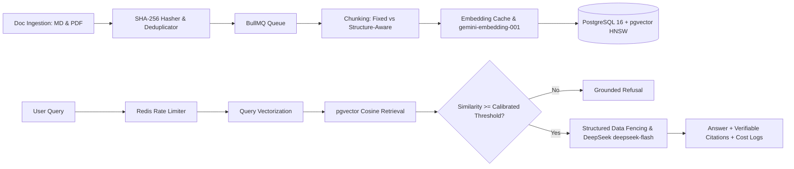

# Grounded — Verifiable RAG Document Intelligence Assistant

Grounded is an enterprise-grade Retrieval-Augmented Generation (RAG) assistant that answers complex operational, financial, and policy questions from a controlled collection of 220 corporate documents with verifiable, clickable citations.

---

## The Problem It Solves

Large language models deployed in corporate environments are prone to hallucinations, outdated assertions, and silent confabulations. Grounded solves this by strictly anchoring all answers in authoritative, versioned company policies for fictional fintech **ApexPay Technologies**. 

Key capabilities:
- **Verifiable Citations:** Every factual statement links directly to an underlying document chunk, section title, and similarity score.
- **Deterministic Refusal:** When relevant evidence is missing or below a calibrated similarity threshold ($\tau \approx 0.68$), Grounded explicitly refuses to guess.
- **Policy Version Precedence:** Explicit version metadata and rules prevent deprecated policies (e.g. 2024 v1.0) from overriding newer authoritative policies (e.g. 2026 v2.0).
- **Dual Chunking Benchmarks:** Directly compares fixed-size sliding window chunking against structure-aware markdown/section chunking across multiple top-$k$ settings.
- **Multi-Tier Injection Defense:** Combines pre-ingestion text sanitization, structured data fencing, system prompt priority invariants, and post-generation citation verification to neutralize indirect prompt injection attacks.
- **Durable Ingestion & Caching:** Uses Redis/BullMQ background jobs with visible progress, skipping unchanged files via SHA-256 content hashes and caching vector embeddings with dimension guards.

---

## Tech Stack

- **Web Frontend & API:** Next.js 15+ (App Router), TypeScript, Tailwind CSS
- **Vector Storage:** PostgreSQL 16 with `pgvector` (HNSW indexing with cosine distance)
- **Background Jobs & Cache:** Redis 7 + BullMQ (`ioredis`) running in a dedicated worker process
- **AI Models:**
  - **Generation:** DeepSeek `deepseek-flash` (via official OpenAI-compatible endpoint `https://api.deepseek.com`, configured with non-thinking mode for rapid, cost-effective grounded synthesis)
  - **Embeddings:** Hugging Face `Xenova/all-MiniLM-L6-v2` (384 dimensions, local semantic embedding pipeline via `@xenova/transformers`)
  - **Offline Fallback:** `DeterministicGroundedSynthesizer` (`grounded-local-synthesizer-v1`) for isolated offline CI/CD and regression tests
  - **Alternative Adapter:** Google Gemini `gemini-2.5-flash` via `@google/genai` (configurable via `LLM_PROVIDER=gemini`)
- **Validation:** Zod v3
- **Testing & Evaluation:** Custom 30-question evaluation harness (25 answerable, 5 unanswerable)

---

## Architecture Summary



Detailed technical specifications, worker process designs, and schema layouts are available in [ARCHITECTURE.md](file:///c:/Users/HP/Desktop/grounded-rag/ARCHITECTURE.md).

---

## Local Development & Setup

### Prerequisites
- Node.js v20+ (tested on Node.js v24.16.0)
- Docker Desktop (for local PostgreSQL with pgvector and Redis)
- DeepSeek API key (obtainable from [platform.deepseek.com](https://platform.deepseek.com/)) or Google AI Studio API key

### Step 1: Clone and Install Dependencies
```bash
git clone <your-repo-url> grounded-rag
cd grounded-rag
npm install
```

### Step 2: Configure Environment
Copy `.env.example` to `.env`:
```bash
cp .env.example .env
```
Fill in your `DEEPSEEK_API_KEY` (or `GEMINI_API_KEY` if using Google Gemini):
```env
LLM_PROVIDER=deepseek
LLM_MODEL=deepseek-flash
DEEPSEEK_BASE_URL=https://api.deepseek.com
DEEPSEEK_API_KEY=sk-...
```

### Step 3: Start Infrastructure (PostgreSQL + pgvector & Redis)
```bash
docker-compose up -d
```

### Step 4: Start the Durable Ingestion Worker (Terminal 1)
```bash
npm run worker
```

### Step 5: Start the Web Application (Terminal 2)
```bash
npm run dev
```
Open [http://localhost:3000](http://localhost:3000) in your browser.

---

## Realistic Cost Scenarios & Infrastructure Limits

1. **Local Development (Current Baseline):** $0.00 cash outlay via local Docker and Google AI Studio free tier. Subject to free tier API rate limits (15 RPM) requiring client-side request pacing during ingestion and evaluation.
2. **Hosted Prototype (Supabase + Upstash + Vercel):** $0.00 cash outlay, but subject to severe constraints (Supabase 7-day pause on inactivity, Upstash 10k daily command limit easily reached by BullMQ, and Vercel inability to run a continuous background worker).
3. **Production Deployment:** ~$35 – $47 / month for managed PostgreSQL with pgvector (Neon/Supabase Pro), persistent Redis, and a persistent background worker host (Render / Railway / VPS).

---

## Project Status

- [x] **Phase 1: Architecture, Research & Evaluation Design** (Completed & Revised)
- [x] **Phase 2: Corpus Generation (220 docs), Ingestion Engine & Vector Indexing** (Completed & Verified)
- [x] **Phase 3: Retrieval Pipeline, Refusal Gate, Web Chat UI & Citations** (Completed & Verified)
- [x] **Phase 4: 30-Question 2x2 Evaluation Matrix & Prompt Injection Defense Verification** (Completed & Verified)
- [ ] **Phase 5: Deployment, Demo Video & Graduation Deliverables**
